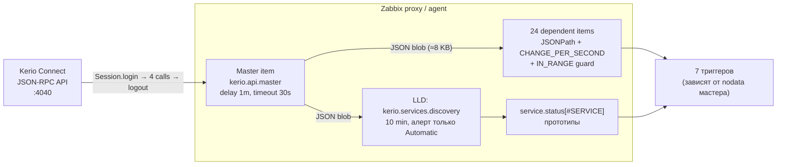
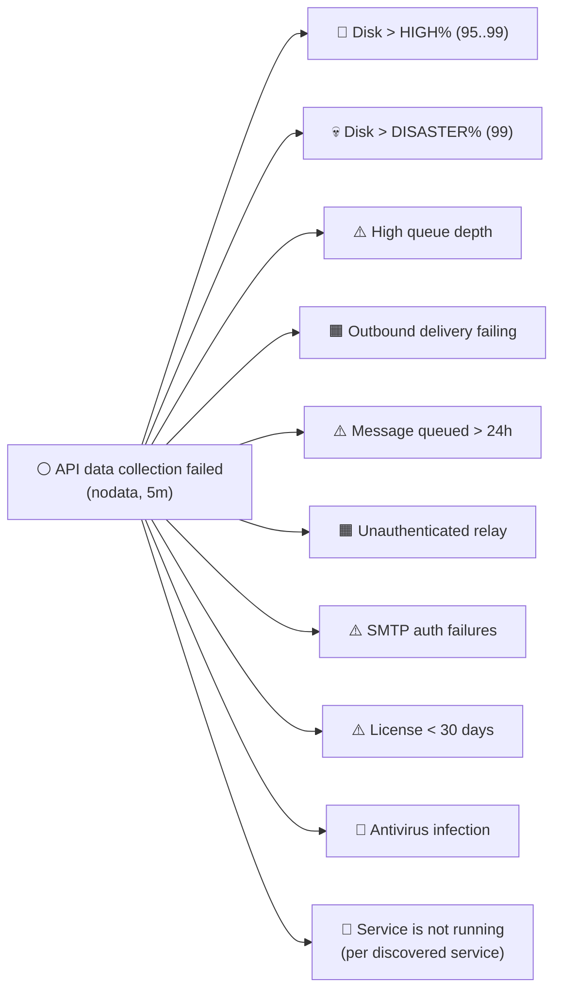

# Zabbix-мониторинг для Kerio Connect

Шаблоны Zabbix 7 для мониторинга почтового сервера **Kerio Connect** через
JSON-RPC Admin API.

📘 [English version](README_EN.md) • 🌐 [itforprof.com](https://itforprof.com)

---

## Архитектура



Один авторизованный сеанс → четыре вызова API → один JSON-объект → 24 зависимых
айтема через JSONPath. LLD создаёт айтем статуса для каждого сервиса.

---

## Что собирается

Мастер-айтем раз в минуту запрашивает 4 метода Kerio Admin API одним
`Batch.run` (`Statistics.get`, `Services.get`, `ProductRegistration.getFullStatus`,
`Server.getVersion`) и отдаёт JSON, из которого зависимые айтемы берут значения
через JSONPath. Kerio закрывает соединение после каждого ответа, поэтому один
опрос — это три HTTP-запроса: вход, batch, выход. Одно правило LLD создаёт айтемы
статуса для каждого обнаруженного сервиса. В шаблоне `by Script` есть ещё два
Script-айтема: очередь (раз в минуту) и проверка релея (раз в час).

| Метрика | Айтем |
|---|---|
| Объём хранилища (всего/занято/процент) | `kerio.disk.total`, `kerio.disk.used`, `kerio.disk.pct` |
| Очередь сообщений | `kerio.queue.total` |
| Возраст самого старого письма в очереди, с (только `by Script`) | `kerio.queue.oldest.age` |
| Письма с временной ошибкой `4.x.x` старше `{$KERIO.QUEUE.STUCK.AGE}` и число их доменов (только `by Script`) | `kerio.queue.stuck`, `kerio.queue.stuck.domains` |
| Неавторизованный SMTP с приватного адреса наружу за час (только `by Script`) | `kerio.relay.unauth.count`, `kerio.relay.unauth.truncated` |
| Время работы сервера | `kerio.uptime.days` |
| Соединения SMTP/IMAP/POP3/LDAP/Web/XMPP | `kerio.{smtp,imap,pop3,ldap,web,xmpp}.connections` |
| Сообщения SMTP вход/исход | `kerio.smtp.messages.{in,out}` |
| Ошибки SMTP-аутентификации | `kerio.smtp.auth.failures` |
| Спам: проверено/отклонено | `kerio.spam.{checked,rejected}` |
| Антивирус: проверено/найдено | `kerio.av.{scanned,infected}` |
| Greylisting и antibombing | `kerio.greylisting.delayed`, `kerio.antibombing.rejected` |
| Лицензия (пользователи, дни, дата) | `kerio.license.{users,days,expiry}` |
| Версия сервера | `kerio.version` |
| Статус каждого сервиса (LLD) | `kerio.service.status[{#SERVICE}]` |

Все счётчики кумулятивные с момента запуска сервера — для них применяется
`CHANGE_PER_SECOND` со страховкой `IN_RANGE [0, 1e9] DISCARD_VALUE` (на случай
рестарта Kerio: счётчики обнуляются, и без защиты получится отрицательная
дельта).

CPU, память и swap **намеренно не включены**: `SystemHealth.get` недоступен под
ролью **Auditor**. Для системных метрик и места на томе хранилища подключайте
параллельно стандартный OS-шаблон Zabbix. Из `Domains.get` под Auditor читаются
только имена доменов (поле `name`) — их использует проверка релея.

Айтемы очереди отдают только агрегаты: адреса из `Queue.get` в историю Zabbix
не попадают. Учитываются 500 самых старых писем: если все они идут в один-два
домена, «Outbound delivery failing» не сработает, даже когда за ними копится свежая почта.

## Триггеры

- ⚪ **API data collection failed** — мастер-айтем не возвращал данных 5 мин.
- 🔴 **Disk usage > {$KERIO.DISK.HIGH}%** — по умолчанию 95 %, High; горит
  до `{$KERIO.DISK.DISASTER}` включительно.
- 💀 **Disk usage > {$KERIO.DISK.DISASTER}%** — по умолчанию 99 %, Disaster;
  при этой отметке Kerio вот-вот перестанет принимать почту. Ступени не
  перекрываются: одно состояние — одна проблема. Пороги 80/90 % даёт
  OS-шаблон (триггеры файловой системы на томе хранилища), в шаблоне Kerio
  их нет, чтобы не дублировать.
- ⚠️ **High message queue depth** — очередь больше `{$KERIO.QUEUE.WARN}`.
- 🟧 **Outbound delivery failing** (только `by Script`) — письма с временной
  ошибкой `4.x.x` старше `{$KERIO.QUEUE.STUCK.AGE}` (1h) ждут доставки в
  `{$KERIO.QUEUE.STUCK.DOMAINS}` (3) и более доменов. Один мёртвый получатель
  этот триггер не поднимает, сломанный путь отправки (релей, NAT, DNS, порт 25)
  поднимает.
- ⚠️ **Message queued longer than {$KERIO.QUEUE.AGE.HIGH}** (только `by Script`)
  — самое старое письмо ждёт дольше 24h. Обычно это мёртвый сервер получателя;
  проблема закрывается сама, когда Kerio вернёт письмо отправителю
  (`bounceInterval` в `Smtp.get`, по умолчанию 3 сут). Исключений по
  получателям нет.
- 🟧 **Unauthenticated relay from a private address** (только `by Script`) — за
  24h в журнале `mail` есть `Recv` с `Service: SMTP` без `User:`, где
  `Sender-Host` — приватный IPv4, а среди получателей есть внешний домен
  (не из `Domains.get`). Признак NAT на пути к Kerio: группа «Local clients»
  разрешает релей без авторизации, и через такой NAT релеить может любой
  клиент из интернета. Конкретные внутренние хосты, которым такой релей
  разрешён, задаются regex `{$KERIO.RELAY.UNAUTH.ALLOW}`; адрес NAT туда не
  вносится. Ограничение: если у адреса NAT есть PTR-запись, Kerio пишет имя
  вместо адреса, и проверка его не видит.
- ⚠️ **Relay check misses part of the hour** — хвост журнала
  `{$KERIO.LOG.LINES}` строк короче часа; поднимите макрос.
- ⚠️ **Queue / Relay check data collection failed** — у Script-айтема очереди
  нет данных 5 мин, у проверки релея — 3 ч.
- ⚠️ **High SMTP authentication failure rate** — частота ошибок
  аутентификации в среднем за 5 мин выше `{$KERIO.SMTP.AUTH.WARN}` в секунду.
- 🔴 **Antivirus infection detected** — KAV обнаружил вредонос.
- ⚠️ **License expires in less than 30 days** — лицензия скоро истекает.
- 🔴 **Service `{#SERVICE}` is not running** — обнаруженный сервис остановлен.

Все триггеры, кроме мастер-«no data», **зависят** от триггера «API data
collection failed». При пропадании API срабатывает один корневой алерт.



## Метки (tags)

У шаблона, элементов и LLD-прототипа проставлены теги — удобно фильтровать
Latest data, маршрутизировать уведомления по подсистемам и строить дашборды.

| Где | Тег | Значение |
|---|---|---|
| Шаблон | `class` | `application` |
| Шаблон | `target` | `kerio-connect` |
| Мастер-айтем | `component` | `raw` |
| Зависимые айтемы | `component` | `storage` · `queue` · `smtp` · `imap` · `pop3` · `ldap` · `web` · `xmpp` · `antispam` · `antivirus` · `greylisting` · `anti-bombing` · `license` · `health` · `info` |
| Прототип сервиса | `component` | `services` |
| Прототип сервиса | `service` | `{#SERVICE}` (имя обнаруженного сервиса) |

## Два варианта шаблона

### Вариант 1 — `Kerio Connect by Script`

Zabbix server или proxy сам ходит в Kerio API. Никаких агентов не нужно.
Подходит, когда из proxy/server есть прямой доступ к `https://<kerio>:4040/`.

Установите макросы на хосте:

| Макрос | Значение |
|---|---|
| `{$KERIO.API.HOST}` | IP/имя сервера Kerio |
| `{$KERIO.API.PORT}` | `4040` |
| `{$KERIO.API.SCHEME}` | `https` |
| `{$KERIO.API.USERNAME}` | служебный пользователь (роль Auditor достаточна) |
| `{$KERIO.API.PASSWORD}` | пароль (Secret macro) |

Пороги очереди и релея (значения по умолчанию подходят большинству):

| Макрос | По умолчанию | Смысл |
|---|---|---|
| `{$KERIO.QUEUE.STUCK.AGE}` | `1h` | возраст, после которого письмо `4.x.x` считается застрявшим |
| `{$KERIO.QUEUE.STUCK.DOMAINS}` | `3` | сколько доменов с застрявшими письмами означает отказ отправки |
| `{$KERIO.QUEUE.AGE.HIGH}` | `24h` | возраст самого старого письма для Warning |
| `{$KERIO.LOG.LINES}` | `5000` | сколько последних строк журнала `mail` читает проверка релея |
| `{$KERIO.RELAY.UNAUTH.ALLOW}` | пусто | regex приватных адресов, которым разрешён релей без авторизации (сверяется с адресом целиком) |

### Вариант 2 — `Kerio Connect by Zabbix agent`

Опрос выполняет агент на самой машине через UserParameter →
`kerio_collector.py`. Учётные данные читаются из локального файла на агенте,
**не из конфига агента и не из макросов Zabbix**.

```bash
install -m 0755 src/kerio_collector.py /opt/zabbix-kerio-connect/src/kerio_collector.py
install -m 0644 template/kerio_connect_agent/zabbix_agent2.d/kerio_connect.conf \
                /etc/zabbix/zabbix_agent2.d/kerio_connect.conf
```

`/etc/zabbix/kerio_connect.conf` (chmod 0600, владелец `zabbix:zabbix`):

```ini
[api]
host = 127.0.0.1
port = 4040
scheme = https
username = zabbix_api
password = <секрет>
```

В `/etc/zabbix/zabbix_agent2.conf` **обязательно** установите `Timeout=30`
(или больше) — четыре HTTPS-запроса с авторизацией не успевают за 3 секунды
по умолчанию.

Перезапустите агента и привяжите шаблон к хосту.

## Какие сервисы алертят

Триггер «сервис не запущен» создаётся **только для сервисов с типом запуска
Automatic**. Тип берётся из поля `howToStart` Kerio API и публикуется в LLD как
макрос `{#STARTTYPE}`; выражение триггера срабатывает только при
`{#STARTTYPE}="Automatic"`, поэтому для Manual-сервисов триггер остаётся, но
никогда не зажигается.

Сервисы в режиме Manual намеренно остановлены — алерт по ним не создаётся, но
status-метрика (`kerio.service.status[…]`) продолжает собираться. Чтобы
перестать получать алерт по Automatic-сервису, переведите его в Manual в самом
Kerio — ручной список исключений в Zabbix вести не нужно.

## Установка

1. Создайте служебного пользователя в Kerio Admin с ролью **Auditor** (Admin
   тоже подойдёт, но Auditor минимально достаточен).
2. Импортируйте YAML шаблона в Zabbix:
   `Configuration → Templates → Import`.
3. Привяжите выбранный шаблон к хосту, заполните макросы.
4. Через минуту проверьте `Monitoring → Latest data` — должны появиться
   значения дисков, лицензии, версии и т. д. Счётчики CHANGE_PER_SECOND
   станут не-нулевыми после второго опроса.

## Проверено на

Kerio Connect 10.0.8.9228 (Windows), роль API-пользователя Auditor,
Zabbix 7.0 и 8.0, опрос с Zabbix server и через Zabbix proxy.

## Разработка

```bash
pytest tests/ -v --ignore=tests/test_deployment.py    # юнит-тесты; JS коллекторов — в node
python3 tools/sync_template_js.py --check             # JS ↔ YAML параллель
```

Подробное описание API-полей и JSONPath: [docs/api_fields.md](docs/api_fields.md).

## Лицензия и автор

Автор: **Konstantin Tyutyunnik** (Константин Тютюнник) ·
[itforprof.com](https://itforprof.com)

Версия шаблона: **1.0.0**
