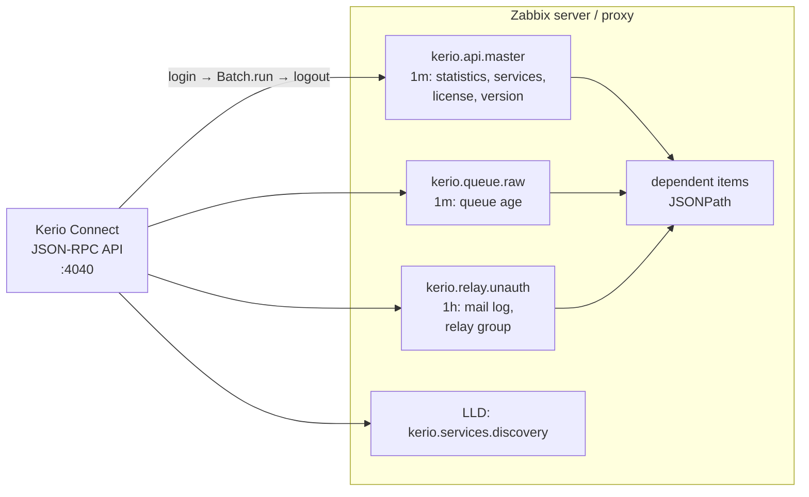
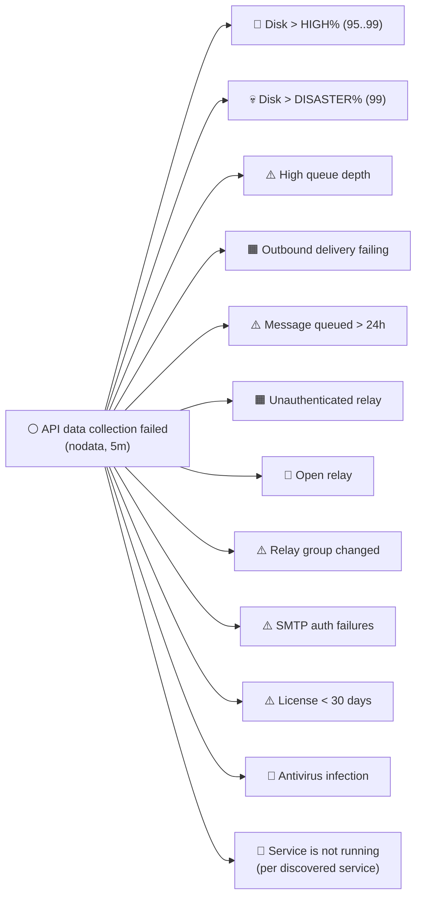

# Zabbix monitoring for Kerio Connect

Zabbix 7 templates that monitor a **Kerio Connect** mail server through its
JSON-RPC Admin API.

📕 [Русская версия](README.md) • 🌐 [itforprof.com](https://itforprof.com)

---

## Architecture



Each Script item opens a session, requests its methods in one `Batch.run` and
closes the session. Dependent items extract values via JSONPath; LLD creates a
status item per discovered service.

---

## What it collects

Once a minute the master item requests four Kerio Admin API methods in one
`Batch.run` (`Statistics.get`, `Services.get`, `ProductRegistration.getFullStatus`,
`Server.getVersion`) and returns one JSON blob; dependent items extract values
via JSONPath. Kerio closes the connection after every response, so a poll is
three HTTP requests: login, batch, logout. A single LLD rule creates a
service-status item per discovered service. The `by Script` template has two
more Script items: the queue (every minute) and the relay check (hourly).

| Metric | Item key |
|---|---|
| Storage (total / used / percent) | `kerio.disk.total`, `kerio.disk.used`, `kerio.disk.pct` |
| Mail queue depth | `kerio.queue.total` |
| Oldest queued message age, s (`by Script` only) | `kerio.queue.oldest.age` |
| Messages with a temporary `4.x.x` status older than `{$KERIO.QUEUE.STUCK.AGE}` and their domain count (`by Script` only) | `kerio.queue.stuck`, `kerio.queue.stuck.domains` |
| Unauthenticated SMTP from a private address to external recipients per hour (`by Script` only) | `kerio.relay.unauth.count`, `kerio.relay.unauth.truncated` |
| Relay restricted or open, entries of the relay IP group (`by Script` only) | `kerio.relay.restricted`, `kerio.relay.group.entries` |
| Server uptime (days) | `kerio.uptime.days` |
| Connections (SMTP/IMAP/POP3/LDAP/Web/XMPP) | `kerio.{smtp,imap,pop3,ldap,web,xmpp}.connections` |
| SMTP messages in/out | `kerio.smtp.messages.{in,out}` |
| SMTP authentication failures | `kerio.smtp.auth.failures` |
| Spam checked / rejected | `kerio.spam.{checked,rejected}` |
| Antivirus scanned / infected | `kerio.av.{scanned,infected}` |
| Greylisting and antibombing | `kerio.greylisting.delayed`, `kerio.antibombing.rejected` |
| License (users, days, expiry) | `kerio.license.{users,days,expiry}` |
| Server version | `kerio.version` |
| Per-service status (LLD) | `kerio.service.status[{#SERVICE}]` |

Counters are cumulative since server start. `CHANGE_PER_SECOND` produces
per-second rates, with `IN_RANGE [0, 1e9] DISCARD_VALUE` to suppress the
negative delta that would otherwise appear after a Kerio restart resets the
counter to zero.

CPU, memory and swap are **intentionally omitted**: `SystemHealth.get` is not
available to the **Auditor** role. Use a regular Zabbix OS template (Windows /
Linux) alongside for system metrics and free space on the store volume. Under
Auditor `Domains.get` returns domain names (field `name`) only; the relay check
uses them.

Queue items return aggregates only: addresses from `Queue.get` never reach
Zabbix history. Only the oldest 500 messages are evaluated: if they all go to one
or two domains, "Outbound delivery failing" stays quiet even while fresh mail piles up behind them.

## Triggers

- ⚪ **API data collection failed** — master item produced no data for 5 min.
- 🔴 **Disk usage > {$KERIO.DISK.HIGH}%** — 95 % default, High; active up to
  `{$KERIO.DISK.DISASTER}` inclusive.
- 💀 **Disk usage > {$KERIO.DISK.DISASTER}%** — 99 % default, Disaster; at this
  point Kerio is about to stop accepting messages. The tiers do not overlap:
  one state, one problem. 80/90 % come from the OS template (file system
  triggers on the store volume); the Kerio template does not duplicate them.
- ⚠️ **High message queue depth** — queue size above `{$KERIO.QUEUE.WARN}`.
- 🟧 **Outbound delivery failing** (`by Script` only) — messages with a temporary
  `4.x.x` status older than `{$KERIO.QUEUE.STUCK.AGE}` (1h) wait for at least
  `{$KERIO.QUEUE.STUCK.DOMAINS}` (3) recipient domains. One dead recipient does
  not raise it; a broken outbound path (relay, NAT, DNS, port 25) does.
- ⚠️ **Message queued longer than {$KERIO.QUEUE.AGE.HIGH}** (`by Script` only) —
  the oldest message waits longer than 24h. Usually a dead recipient server;
  the problem clears when Kerio returns the message to the sender
  (`bounceInterval` in `Smtp.get`, 3 days by default). No recipient exclusions.
- 🟧 **Unauthenticated relay from a private address** (`by Script` only) — in the
  last 24h the `mail` log has a `Recv` line with `Service: SMTP`, no `User:`, a
  private IPv4 `Sender-Host` and an external recipient (not in `Domains.get`).
  This means NAT sits on the path to Kerio. The relay group from Relay Control
  (often "Local clients") allows relay
  without authentication, so any Internet client behind such NAT can relay.
  Specific internal hosts allowed to do this go into the regex
  `{$KERIO.RELAY.UNAUTH.ALLOW}`; never put a NAT address there. Limitation: if
  the NAT address has a PTR record, Kerio logs the name instead of the address
  and the check does not see it.
- 🔴 **Open relay** (`by Script` only) — Kerio Relay Control does not restrict
  relaying (`Smtp.get` → `relayControl.isRestricted` = false): the server relays
  mail for anyone.
- ⚠️ **Relay group changed** (`by Script` only) — the IP group Kerio lets relay
  without authentication changed (`kerio.relay.group.entries`, value repeated
  once a day). Check every new public address and the firewall rules that mirror
  this group.
- ⚠️ **Relay check misses part of the hour** — the `{$KERIO.LOG.LINES}`-line log
  tail is shorter than one hour; raise the macro.
- ⚠️ **Queue / Relay check data collection failed** — no data from the queue
  Script item for 5 min, from the relay check for 3 h.
- ⚠️ **High SMTP authentication failure rate** — 5-minute average of
  auth-failure rate exceeds `{$KERIO.SMTP.AUTH.WARN}` per second.
- 🔴 **Antivirus infection detected** — Kerio AV flagged a message.
- ⚠️ **License expires in less than 30 days** — renew soon.
- 🔴 **Service `{#SERVICE}` is not running** — a discovered service is stopped.

Every trigger except the master *no-data* trigger **depends** on "API data
collection failed". When the API goes down only that single root alert fires.



## Tags

Items, triggers and the LLD prototype carry tags so you can filter Latest
data, route notifications by subsystem, or scope dashboards.

| Scope | Tag | Value |
|---|---|---|
| Template | `class` | `application` |
| Template | `target` | `kerio-connect` |
| Master item | `component` | `raw` |
| Dependent items | `component` | `storage` · `queue` · `smtp` · `imap` · `pop3` · `ldap` · `web` · `xmpp` · `antispam` · `antivirus` · `greylisting` · `anti-bombing` · `license` · `health` · `info` |
| Service prototype | `component` | `services` |
| Service prototype | `service` | `{#SERVICE}` (discovered service name) |

## Two template flavours

### Variant 1 — `Kerio Connect by Script`

Zabbix server or proxy calls the Kerio API directly. No agent required. Use
this when the proxy/server can reach `https://<kerio>:4040/`.

Set host macros:

| Macro | Value |
|---|---|
| `{$KERIO.API.HOST}` | Kerio host or IP |
| `{$KERIO.API.PORT}` | `4040` |
| `{$KERIO.API.SCHEME}` | `https` |
| `{$KERIO.API.USERNAME}` | service user (Auditor role is enough) |
| `{$KERIO.API.PASSWORD}` | password (Secret macro) |

Queue and relay thresholds (defaults fit most servers):

| Macro | Default | Meaning |
|---|---|---|
| `{$KERIO.QUEUE.STUCK.AGE}` | `1h` | age after which a `4.x.x` message counts as stuck |
| `{$KERIO.QUEUE.STUCK.DOMAINS}` | `3` | how many domains with stuck messages mean outbound delivery is failing |
| `{$KERIO.QUEUE.AGE.HIGH}` | `24h` | oldest message age for the Warning |
| `{$KERIO.LOG.LINES}` | `5000` | how many last `mail` log lines the relay check reads |
| `{$KERIO.RELAY.UNAUTH.ALLOW}` | empty | regex of private addresses allowed to relay without authentication (matched against the whole address) |

### Variant 2 — `Kerio Connect by Zabbix agent`

A Zabbix agent on the host runs `kerio_collector.py` via a UserParameter.
Credentials live in a local config file — **not** in `zabbix_agent2.conf`,
because Zabbix host macros are not expanded inside that file.

```bash
install -m 0755 src/kerio_collector.py /opt/zabbix-kerio-connect/src/kerio_collector.py
install -m 0644 template/kerio_connect_agent/zabbix_agent2.d/kerio_connect.conf \
                /etc/zabbix/zabbix_agent2.d/kerio_connect.conf
```

Create `/etc/zabbix/kerio_connect.conf` (chmod `0600`, owner `zabbix:zabbix`):

```ini
[api]
host = 127.0.0.1
port = 4040
scheme = https
username = zabbix_api
password = <secret>
```

In `/etc/zabbix/zabbix_agent2.conf` you **must** set `Timeout=30` (or higher)
— four HTTPS calls with login don’t fit in the default 3 seconds.

Restart the agent and link the template to the host.

## Which services alert

The "service is not running" trigger is created **only for services with start
type Automatic**. The start type comes from the Kerio API `howToStart` field,
exposed as the LLD macro `{#STARTTYPE}`; the trigger expression fires only when
`{#STARTTYPE}="Automatic"`, so Manual-start services keep their trigger but it
never goes off.

Manual-start services are intentionally stopped, so they never alert — but their
status metric (`kerio.service.status[…]`) is still collected. To stop alerting
on an Automatic service, set its start type to Manual in Kerio itself; there is
no hand-maintained exclude list in Zabbix.

## Installation

1. Create a Kerio Admin service user with the **Auditor** role (Admin works
   too, but Auditor is the minimum).
2. Import the YAML template in Zabbix:
   `Configuration → Templates → Import`.
3. Link the template to the host and set the macros.
4. After one minute, check `Monitoring → Latest data` — disk, license,
   version etc. should be populated. `CHANGE_PER_SECOND` counters become
   non-zero after the second poll cycle.

## Verified against

Kerio Connect 10.0.8.9228 (Windows), API user with Auditor role, Zabbix 7.0 and 8.0,
collection from Zabbix server and via Zabbix proxy.

## Development

```bash
pytest tests/ -v --ignore=tests/test_deployment.py    # unit tests; collector JS runs in node
python3 tools/sync_template_js.py --check             # JS ↔ YAML parity
```

Detailed field/JSONPath reference: [docs/api_fields.md](docs/api_fields.md).

## License & author

Author: **Konstantin Tyutyunnik** (Константин Тютюнник) ·
[itforprof.com](https://itforprof.com)

Template version: **1.0.0**
